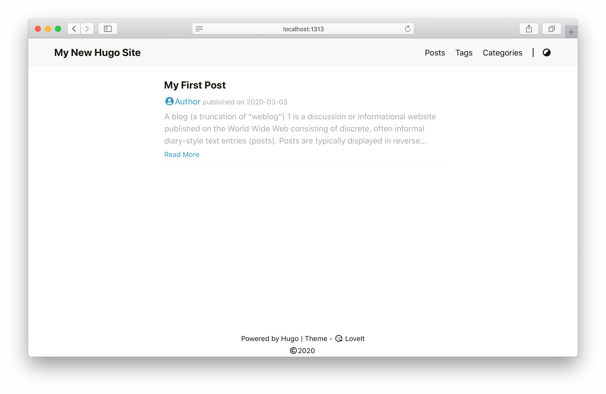
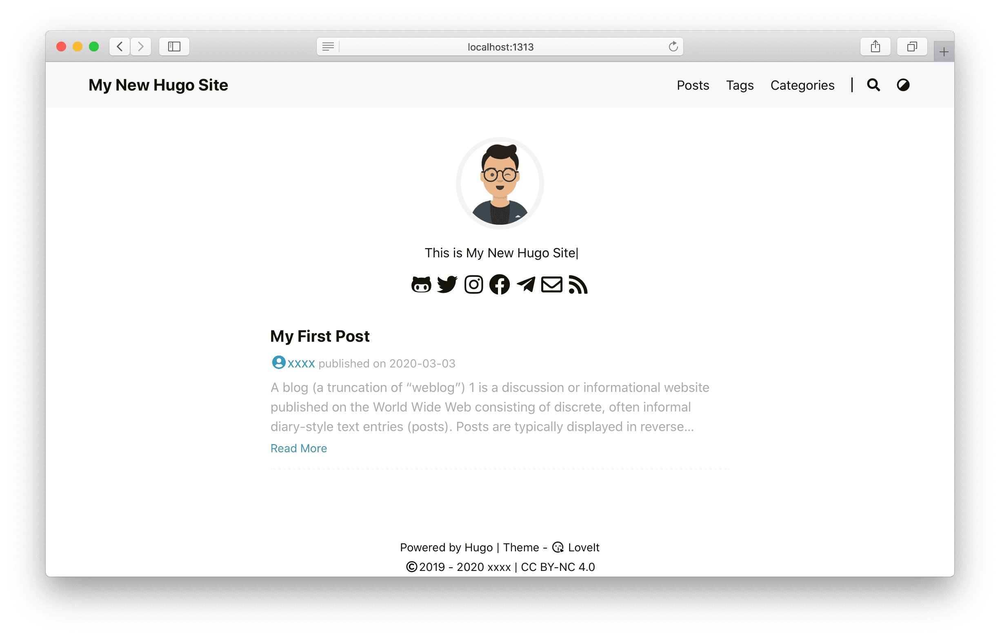
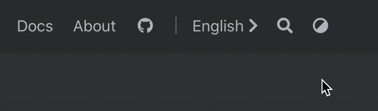

Discover what the Hugo - **LoveIt** theme is all about and the core-concepts behind it.

<!--more-->

## 1 Requirements

Thanks to the simplicity of Hugo, [Hugo](https://gohugo.io/) is the only dependency of this theme.

Just install latest edition of [:(far fa-file-archive): Hugo](https://gohugo.io/getting-started/installing/) for your OS (**Windows**, **Linux**, **macOS**).




**LoveIt 0.4.X** requires **Hugo 0.146.0 or later** and [**Dart Sass**](https://gohugo.io/functions/css/sass/#dart-sass).
Install Dart Sass next to Hugo; the extended edition of Hugo is not enough, and Hugo 0.170.0 no longer ships one.

If you are upgrading from LoveIt 0.3.X, read [Upgrade from 0.3.X](#upgrade-from-0-3) first.


## 2 Installation

The following steps are here to help you initialize your new website. If you don’t know Hugo at all, we strongly suggest you learn more about it by following this [great documentation for beginners](https://gohugo.io/getting-started/quick-start/).

### 2.1 Create Your Project

Hugo provides a `new` command to create a new website:

```bash
hugo new site my_website
cd my_website
```

### 2.2 Install the Theme

The **LoveIt** theme's repository is: [https://github.com/dillonzq/LoveIt](https://github.com/dillonzq/LoveIt).

You can download the [release :(far fa-file-archive): .zip file](https://github.com/dillonzq/LoveIt/releases) of the theme and extract it in the `themes` directory.

Alternatively, clone this repository to the `themes` directory:

```bash
git clone https://github.com/dillonzq/LoveIt.git themes/LoveIt
```

Or, create an empty git repository and make this repository a submodule of your site directory:

```bash
git init
git submodule add https://github.com/dillonzq/LoveIt.git themes/LoveIt
```


Build services such as Netlify, Vercel, Cloudflare Pages and GitHub Actions build from your site's repository,
so the theme must be in it as a submodule (`git submodule add`, as above).
If you `git clone` the theme into `themes/` inside your site repository and commit it,
Git records only a reference to the nested repository, not its files.
The site then builds on your computer but not on the service,
which reports errors such as `template for shortcode "typeit" not found`
or `found no layout file for "html" for kind "home"`.
If you have already committed such a clone, turn it into a submodule
(`git submodule add` reuses the existing clone):

```bash
git rm --cached themes/LoveIt
git submodule add https://github.com/dillonzq/LoveIt.git themes/LoveIt
git commit -m "Add LoveIt as a submodule"
```

If you changed the theme in that clone, push your commits to a fork and use the fork's URL instead:
a build service can only fetch commits that exist in the submodule's repository.

With GitHub Actions, check out the submodules too (`submodules: true` for `actions/checkout`).
Also set the Hugo version the service uses (for example the `HUGO_VERSION` environment variable on Netlify and Vercel)
to one this theme supports: older Hugo versions report the same `found no layout file` warnings.




| LoveIt branch or version | Supported Hugo versions |
|:-------------------------|:-----------------------:|
| master(Unstable)         |        ≥ 0.146.0        |
| **0.4.X(Recommended)**   |        ≥ 0.146.0        |
| 0.3.X                    |    0.128.0 - 0.145.0    |
| 0.2.X(Outdated)          |    0.68.0 - 0.127.0     |



### 2.3 Basic Configuration {#basic-configuration}

The following is a basic configuration for the LoveIt theme:

```toml
baseURL = "http://example.org/"

# Change the default theme to be used when building the site with Hugo
theme = "LoveIt"

# website title
title = "My New Hugo Site"

# language code ["en", "zh-CN", "fr", "pl", ...]
locale = "en"
# language name ["English", "简体中文", "Français", "Polski", ...]
label = "English"

# Menu config
[menu]
  [[menu.main]]
    weight = 1
    identifier = "posts"
    # you can add extra information before the name (HTML format is supported), such as icons
    pre = ""
    # you can add extra information after the name (HTML format is supported), such as icons
    post = ""
    name = "Posts"
    url = "/posts/"
    # title will be shown when you hover on this menu link
    title = ""
  [[menu.main]]
    weight = 2
    identifier = "tags"
    pre = ""
    post = ""
    name = "Tags"
    url = "/tags/"
    title = ""
  [[menu.main]]
    weight = 3
    identifier = "categories"
    pre = ""
    post = ""
    name = "Categories"
    url = "/categories/"
    title = ""

# Markup related configuration in Hugo
[markup]
  # Syntax Highlighting (https://gohugo.io/content-management/syntax-highlighting)
  [markup.highlight]
    # false is a necessary configuration (https://github.com/dillonzq/LoveIt/issues/158)
    noClasses = false
```


When building the website, you can set a theme by using `--theme` option. However, we suggest you modify the configuration file (**hugo.toml**) and set the theme as the default.


### 2.4 Create Your First Post

Here is the way to create your first post:

```bash
hugo new posts/first_post.md
```

Feel free to edit the post file by adding some sample content and replacing the title value in the beginning of the file.


By default all posts and pages are created as a draft. If you want to render these pages, remove the property `draft: true` from the metadata, set the property `draft: false` or add `-D`/`--buildDrafts` parameter to `hugo` command.


### 2.5 Launching the Website Locally

Launch by using the following command:

```bash
hugo serve
```

Go to `http://localhost:1313`.




When you run `hugo serve`, when the contents of the files change, the page automatically refreshes with the changes.



Since the theme uses `.Scratch` in Hugo to implement some features,
it is highly recommended that you add `--disableFastRender` parameter to `hugo server` command for the live preview of the page you are editing.

```bash
hugo serve --disableFastRender
```



### 2.6 Build the Website

When your site is ready to deploy, run the following command:

```bash
hugo
```

A `public` folder will be generated, containing all static content and assets for your website. It can now be deployed on any web server.


The website can be automatically published and hosted with [Netlify](https://www.netlify.com/) (Read more about [Automated HUGO deployments with Netlify](https://www.netlify.com/blog/2015/07/30/hosting-hugo-on-netlifyinsanely-fast-deploys/)).
Alternatively, you can use [AWS Amplify](https://gohugo.io/hosting-and-deployment/hosting-on-aws-amplify/), [Github pages](https://gohugo.io/hosting-and-deployment/hosting-on-github/), [Render](https://gohugo.io/hosting-and-deployment/hosting-on-render/) and more...


## 3 Configuration

### 3.1 Site Configuration {#site-configuration}

In addition to [Hugo global configuration](https://gohugo.io/overview/configuration/) and [menu configuration](#basic-configuration), **LoveIt** lets you define the following parameters in your site configuration (here is a `hugo.toml`, whose values are default).

Please open the code block below to view the complete sample configuration :(far fa-hand-point-down)::

```toml
baseURL = "http://example.org/"

# Change the default theme to be used when building the site with Hugo
theme = "LoveIt"

# website title
title = "My New Hugo Site"

# language code ["en", "zh-CN", "fr", "pl", ...]
locale = "en"
# language name ["English", "简体中文", "Français", "Polski", ...]
label = "English"
# whether to include Chinese/Japanese/Korean
hasCJKLanguage = false

# copyright description used only for seo schema
copyright = ""

# whether to use robots.txt
enableRobotsTXT = true
# whether to use git commit log
enableGitInfo = true
# whether to use emoji code
enableEmoji = true

# Pagination config
[pagination]
  disableAliases = false
  pagerSize = 10
  path = "page"

# Menu config
[menu]
  [[menu.main]]
    weight = 1
    identifier = "posts"
    # you can add extra information before the name (HTML format is supported), such as icons
    pre = ""
    # you can add extra information after the name (HTML format is supported), such as icons
    post = ""
    name = "Posts"
    url = "/posts/"
    # title will be shown when you hover on this menu link
    title = ""
  [[menu.main]]
    weight = 2
    identifier = "tags"
    pre = ""
    post = ""
    name = "Tags"
    url = "/tags/"
    title = ""
  [[menu.main]]
    weight = 3
    identifier = "categories"
    pre = ""
    post = ""
    name = "Categories"
    url = "/categories/"
    title = ""

[params]
  # site default theme ["auto", "light", "dark"]
  defaultTheme = "auto"
  # public git repo url only then enableGitInfo is true
  gitRepo = ""
  #  which hash function used for SRI, when empty, no SRI is used
  # ["sha256", "sha384", "sha512", "md5"]
  fingerprint = ""
  #  date format
  dateFormat = "2006-01-02"
  # website title for Open Graph and Twitter Cards
  title = "My cool site"
  # website description for RSS, SEO, Open Graph and Twitter Cards
  description = "This is my cool site"
  # default images for Open Graph and Twitter Cards when a page has none (path under "static/" or "assets/", or a URL)
  images = []

# Author config
  [params.author]
    name = "xxxx"
    email = ""
    link = ""
    #  author avatar shown in the post meta instead of the user icon (path under "static/" or "assets/", or URL)
    avatar = ""

  # Header config
  [params.header]
    # desktop header mode ["fixed", "normal", "auto"]
    desktopMode = "fixed"
    # mobile header mode ["fixed", "normal", "auto"]
    mobileMode = "auto"
    #  Header title config
    [params.header.title]
      # URL of the LOGO
      logo = ""
      # title name
      name = "My cool site"
      # you can add extra information before the name (HTML format is supported), such as icons
      pre = ""
      # you can add extra information after the name (HTML format is supported), such as icons
      post = ""
      #  whether to use typeit animation for title name
      typeit = false

  # Footer config
  [params.footer]
    enable = true
    #  Custom content (HTML format is supported)
    custom = ''
    #  whether to show Hugo and theme info
    hugo = true
    #  whether to show copyright info
    copyright = true
    #  whether to show the author
    author = true
    # Site creation time
    since = 2022
    # ICP info only in China (HTML format is supported)
    icp = ""
    # license info (HTML format is supported)
    license = ""

  #  Section (all posts) page config
  [params.section]
    # special amount of posts in each section page
    paginate = 20
    # date format (month and day)
    dateFormat = "01-02"
    # amount of RSS pages
    rss = 10

  #  List (category or tag) page config
  [params.list]
    # special amount of posts in each list page
    paginate = 20
    # date format (month and day)
    dateFormat = "01-02"
    # amount of RSS pages
    rss = 10

  #  App icon config
  [params.app]
    # optional site title override for the app when added to an iOS home screen or Android launcher
    title = "My cool site"
    # whether to omit favicon resource links
    noFavicon = false
    # modern SVG favicon to use in place of older style .png and .ico files
    svgFavicon = ""
    # Android browser theme color
    themeColor = "#ffffff"
    # Safari mask icon color
    iconColor = "#5bbad5"
    # Windows v8-11 tile color
    tileColor = "#da532c"

  #  Search config
  [params.search]
    enable = false
    #  type of search engine ["lunr", "algolia", "fuse", "pagefind"]
    type = "lunr"
    # max index length of the chunked content
    contentLength = 4000
    # placeholder of the search bar
    placeholder = ""
    #  max number of results length
    maxResultLength = 10
    #  snippet length of the result
    snippetLength = 30
    #  HTML tag name of the highlight part in results
    highlightTag = "em"
    #  whether to use the absolute URL based on the baseURL in search index
    absoluteURL = false
    [params.search.algolia]
      index = ""
      appID = ""
      searchKey = ""
    #   options
    [params.search.fuse]
      isCaseSensitive = false
      minMatchCharLength = 2
      findAllMatches = false
      location = 0
      threshold = 0.3
      distance = 100
      ignoreLocation = false
    #   config
    [params.search.pagefind]
      # directory of the Pagefind index, relative to the baseURL
      basePath = "/_pagefind/"

  # Home page config
  [params.home]
    #  amount of RSS pages
    rss = 10
    # Home page profile
    [params.home.profile]
      enable = true
      # Gravatar Email for preferred avatar in home page
      gravatarEmail = ""
      # URL of avatar shown in home page
      avatarURL = ""
      #  title shown in home page (HTML format is supported)
      title = ""
      # subtitle shown in home page (HTML format is supported)
      subtitle = "This is my cool site"
      # whether to use typeit animation for subtitle
      typeit = true
      #  extra text shown below the subtitle, such as a quote or a short summary (HTML format is supported)
      extra = ""
      #  whether to show the extra text in italic
      extraItalic = true
      # whether to show social links
      social = true
      #  disclaimer (HTML format is supported)
      disclaimer = ""
    # Home page posts
    [params.home.posts]
      enable = true
      # special amount of posts in each home posts page
      paginate = 6

  # Social config about the author
  [params.social]
    GitHub = ""
    Linkedin = ""
    X = "" # 
    Twitter = "" # 
    Instagram = ""
    Facebook = ""
    Telegram = ""
    Medium = ""
    Gitlab = ""
    Youtubelegacy = ""
    Youtubecustom = ""
    Youtubechannel = ""
    Tumblr = ""
    Quora = ""
    Keybase = ""
    Pinterest = ""
    Reddit = ""
    Codepen = ""
    FreeCodeCamp = ""
    Bitbucket = ""
    Stackoverflow = ""
    Weibo = ""
    Odnoklassniki = ""
    VK = ""
    Flickr = ""
    Xing = ""
    Snapchat = ""
    Soundcloud = ""
    Spotify = ""
    Bandcamp = ""
    Paypal = ""
    Fivehundredpx = ""
    Mix = ""
    Goodreads = ""
    Lastfm = ""
    Foursquare = ""
    Hackernews = ""
    Kickstarter = ""
    Patreon = ""
    Steam = ""
    Twitch = ""
    Strava = ""
    Skype = ""
    Whatsapp = ""
    Zhihu = ""
    Douban = ""
    Angellist = ""
    Slidershare = ""
    Jsfiddle = ""
    Deviantart = ""
    Behance = ""
    Dribbble = ""
    Wordpress = ""
    Vine = ""
    Googlescholar = ""
    Researchgate = ""
    Mastodon = ""
    Thingiverse = ""
    Devto = ""
    Gitea = ""
    XMPP = ""
    Matrix = ""
    Bilibili = ""
    Discord = ""
    DiscordInvite = ""
    Lichess = ""
    ORCID = ""
    Pleroma = ""
    Kaggle = ""
    MediaWiki = ""
    Plume = ""
    HackTheBox = ""
    RootMe = ""
    Malt = "" # 
    TikTok = "" # 
    TryHackMe = "" # 
    Codeberg = "" # 
    HuggingFace = "" # 
    Threads = "" # 
    LeetCode = "" # 
    LeetCodeCN = ""
    Bluesky = "" # 
    Email = ""
    Phone = ""
    RSS = "" # 

  #  Page global config
  [params.page]
    #  whether to hide a page from home page
    hiddenFromHomePage = false
    #  whether to hide a page from search results
    hiddenFromSearch = false
    #  whether to enable twemoji
    twemoji = false
    # whether to enable lightgallery
    lightgallery = false
    #  whether to enable the ruby extended syntax
    ruby = true
    #  whether to enable the fraction extended syntax
    fraction = true
    #  whether to enable the fontawesome extended syntax
    fontawesome = true
    #  when to load the Font Awesome stylesheet and webfonts ["auto", true, false]
    # "auto": only on pages whose content or configured HTML (menu, footer...) uses Font Awesome classes,
    # the theme's own icons are inline SVG; true: always, e.g. for your own layouts that use them; false: never
    fontawesomeCSS = "auto"
    # whether to show link to Raw Markdown content of the content
    linkToMarkdown = true
    #  whether to show the full text content in RSS
    rssFullText = false
    #  Table of the contents config
    [params.page.toc]
      # whether to enable the table of the contents
      enable = true
      #  whether to keep the static table of the contents in front of the post
      keepStatic = false
      # whether to make the table of the contents in the sidebar automatically collapsed
      auto = true
    #   mathematical formulas
    [params.page.math]
      enable = false
      #  default inline delimiter is $ ... $ and \( ... \)
      inlineLeftDelimiter = ""
      inlineRightDelimiter = ""
      #  default block delimiter is $$ ... $$, \[ ... \], \begin{equation} ... \end{equation} and some other functions
      blockLeftDelimiter = ""
      blockRightDelimiter = ""
      # KaTeX extension copy_tex
      copyTex = true
      # KaTeX extension mhchem
      mhchem = true
    #  Code config
    [params.page.code]
      # whether to show the copy button of the code block
      copy = true
      # the maximum number of lines of displayed code by default
      maxShownLines = 50
    [params.page.code.render]
      # whether to render goat diagrams in code blocks
      goat = true
      # whether to render mermaid diagrams in code blocks
      mermaid = true
    #  Mermaid diagram config
    [params.page.mermaid]
      # renderer of the mermaid code blocks and shortcodes ["pele", "mermaid"]
      # "pele": the lightweight  renderer, colors follow the theme without re-rendering,
      # but its layout differs from Mermaid and it has no HTML labels or click callbacks
      # "mermaid": the  library
      renderer = "pele"
    #   config
    [params.page.mapbox]
      # access token of Mapbox GL JS
      accessToken = ""
      # style for the light theme
      lightStyle = "mapbox://styles/mapbox/light-v10?optimize=true"
      # style for the dark theme
      darkStyle = "mapbox://styles/mapbox/dark-v10?optimize=true"
      # whether to add 
      navigation = true
      # whether to add 
      geolocate = true
      # whether to add 
      scale = true
      # whether to add 
      fullscreen = true
    #   config for the music shortcode
    [params.page.music]
      # Meting API URL, supports :server, :type, :id, :auth and :r placeholders
      api = "https://api.injahow.cn/meting/?server=:server&type=:type&id=:id&r=:r"
    #  social share links in post page
    [params.page.share]
      enable = true
      X = true # 
      Twitter = false # 
      Threads = true # 
      Facebook = true
      Linkedin = false
      Whatsapp = false
      Viber = false
      Pinterest = false
      Tumblr = false
      HackerNews = true
      Reddit = false
      VK = false
      Buffer = false
      Xing = false
      Line = true
      Instapaper = false
      Pocket = false # 
      Flipboard = false
      Weibo = true
      Blogger = false
      Baidu = false # 
      Odnoklassniki = false
      Evernote = false
      Skype = false # 
      Trello = false
      Diaspora = true # 
      Mix = false
      Telegram = true # 
      Bluesky = false # 
      Email = false # 
      Douban = false # 
      Qzone = false # 
      Pinboard = false # 
      WordPress = false # 
    #  Comment config
    [params.page.comment]
      enable = false
      #  comment config
      [params.page.comment.disqus]
        # 
        enable = false
        # Disqus shortname to use Disqus in posts
        shortname = ""
      #  comment config
      # clientSecret is published in any page with Gitalk enabled, see "Notes about comment systems" below
      [params.page.comment.gitalk]
        # 
        enable = false
        owner = ""
        repo = ""
        clientId = ""
        clientSecret = ""
      #  comment config
      # GPL-2.0-only, stores comments in LeanCloud, see "Notes about comment systems" below
      [params.page.comment.valine]
        enable = false
        appId = ""
        appKey = ""
        placeholder = ""
        avatar = "mp"
        meta= ""
        pageSize = 10
        # automatically adapt the current theme i18n configuration when empty
        lang = ""
        visitor = true
        recordIP = true
        highlight = true
        enableQQ = false
        serverURLs = ""
        #  emoji data file name, default is "google.yml"
        # ["apple.yml", "google.yml", "facebook.yml", "twitter.yml"]
        # located in "themes/LoveIt/assets/lib/valine/emoji/" directory
        # you can store your own data files in the same path under your project:
        # "assets/lib/valine/emoji/"
        emoji = ""
      #  config
      [params.page.comment.facebook]
        enable = false
        width = "100%"
        numPosts = 10
        appId = ""
        # automatically adapt the current theme i18n configuration when empty
        languageCode = ""
      #   config
      [params.page.comment.telegram]
        enable = false
        siteID = ""
        limit = 5
        height = ""
        color = ""
        colorful = true
        dislikes = false
        outlined = false
      #   comment config
      # the hosted Commento script no longer serves Commento, see "Notes about comment systems" below
      [params.page.comment.commento]
        enable = false
      #   comment config
      [params.page.comment.utterances]
        enable = false
        # owner/repo
        repo = ""
        issueTerm = "pathname"
        label = ""
        lightTheme = "github-light"
        darkTheme = "github-dark"
      # giscus comment config (https://giscus.app/)
      [params.page.comment.giscus]
        # You can refer to the official documentation of giscus to use the following configuration.
        enable = false
        repo = ""
        repoId = ""
        category = "Announcements"
        categoryId = ""
        # automatically adapt the current theme i18n configuration when empty
        lang = ""
        mapping = "pathname"
        reactionsEnabled = "1"
        emitMetadata = "0"
        inputPosition = "bottom"
        lazyLoading = false
        lightTheme = "light"
        darkTheme = "dark"
      #   comment config
      #  the bundled client is Waline v3, which requires a Waline server v1.27.0 or later
      [params.page.comment.waline]
        enable = false
        serverURL = ""
        # automatically adapt the current theme i18n configuration when empty
        lang = ""
        # emoji presets, the Waline default is used when empty
        emoji = []
    #  Third-party library config
    [params.page.library]
      [params.page.library.css]
        # someCSS = "some.css"
        # located in "assets/"
        # Or
        # someCSS = "https://cdn.example.com/some.css"
      [params.page.library.js]
        # someJavascript = "some.js"
        # located in "assets/"
        # Or
        # someJavascript = "https://cdn.example.com/some.js"
    #  Page SEO config
    [params.page.seo]
      # image URL
      images = []
      # Publisher info
      [params.page.seo.publisher]
        name = ""
        logoUrl = ""

  #  TypeIt config
  [params.typeit]
    # typing speed between each step (measured in milliseconds)
    speed = 100
    # blinking speed of the cursor (measured in milliseconds)
    cursorSpeed = 1000
    # character used for the cursor (HTML format is supported)
    cursorChar = "|"
    # cursor duration after typing finishing (measured in milliseconds, "-1" means unlimited)
    duration = -1

  # Site verification code config for Google/Bing/Yandex/Pinterest/Baidu
  [params.verification]
    google = ""
    bing = ""
    yandex = ""
    pinterest = ""
    baidu = ""

  #  Security config
  [params.security]
    # Content-Security-Policy meta tag, for when HTTP headers cannot be set
    # https://content-security-policy.com/examples/meta/
    contentSecurityPolicy = ""
    #  referrer policy of the <meta name="referrer"> tag
    # set "no-referrer" to send no Referer header at all
    referrerPolicy = "strict-origin-when-cross-origin"
    #  Mermaid securityLevel ["strict", "loose"], used when params.page.mermaid.renderer is "mermaid"
    # "loose" allows click events and HTML labels in diagrams
    mermaidSecurityLevel = "strict"

  #  Site SEO config
  [params.seo]
    # image URL
    image = ""
    # thumbnail URL
    thumbnailUrl = ""

  #  Analytics config
  [params.analytics]
    # whether to show the GoatCounter page view counter in the post footer (only with goatCounter.code set), not set by default
    enable = false
    # Google Analytics
    [params.analytics.google]
      id = ""
      #  whether to respect the browser’s “do not track” setting
      respectDoNotTrack = false
    # Fathom Analytics
    [params.analytics.fathom]
      id = ""
      # server url for your tracker if you're self hosting
      server = ""
    # Plausible Analytics
    [params.analytics.plausible]
      dataDomain = ""
    # Yandex Metrica
    [params.analytics.yandexMetrica]
      id = ""
    #  GoatCounter Analytics
    [params.analytics.goatCounter]
      # the code of your site, as in https://<code>.goatcounter.com
      code = ""

  #  Cookie consent config
  [params.cookieconsent]
    enable = false
    # text strings used for Cookie consent banner
    [params.cookieconsent.content]
      message = ""
      dismiss = ""
      link = ""

  #  CDN config for third-party library files
  [params.cdn]
    # CDN data file name, default is "jsdelivr.yml", set to "" to serve the bundled local files
    # ["jsdelivr.yml"]
    # located in "themes/LoveIt/assets/data/cdn/" directory
    # you can store your own data files in the same path under your project:
    # "assets/data/cdn/"
    data = "jsdelivr.yml"

# Markup related config in Hugo
[markup]
  # 
  [markup.highlight]
    codeFences = true
    guessSyntax = true
    lineNos = true
    lineNumbersInTable = true
    # false is a necessary configuration
    # ()
    noClasses = false
  # Goldmark is from Hugo 0.60 the default library used for Markdown
  [markup.goldmark]
    [markup.goldmark.extensions]
      definitionList = true
      footnote = true
      linkify = true
      strikethrough = true
      table = true
      taskList = true
      typographer = true
    [markup.goldmark.renderer]
      # whether to use HTML tags directly in the document
      unsafe = true
  # Table Of Contents settings
  [markup.tableOfContents]
    startLevel = 2
    endLevel = 6

# Sitemap config
[sitemap]
  changefreq = "weekly"
  filename = "sitemap.xml"
  priority = 0.5

# 
[Permalinks]
  # posts = ":year/:month/:contentbasename"
  posts = ":contentbasename"

# 
[privacy]
  #  privacy of the Google Analytics (can also be configured in params.analytics.google)
  [privacy.googleAnalytics]
    # ...
  [privacy.twitter]
    # ...
  [privacy.youtube]
    # ...

# Options to make output .md files
[mediaTypes]
  [mediaTypes."text/plain"]
    suffixes = ["md"]

# Options to make output .md files
[outputFormats.MarkDown]
  mediaType = "text/plain"
  isPlainText = true
  isHTML = false

# Options to make hugo output files
[outputs]
  # 
  home = ["HTML", "RSS", "JSON"]
  page = ["HTML", "MarkDown"]
  section = ["HTML", "RSS"]
  taxonomy = ["HTML", "RSS"]
```


Note that some of these parameters are explained in details in other sections of this documentation.



Default environments are `development` with `hugo serve` and `production` with `hugo`.

Due to limitations in the local `development` environment,
the **comment system**, **CDN** and **fingerprint** will not be enabled in the `development` environment.

You could enable these features with `hugo serve -e production`.



For a new site, [giscus](https://giscus.app/) is recommended.
It stores comments in GitHub Discussions and does not need any secret in your site.
The notes below were checked on November 26, 2026.

**Gitalk**: the theme bundles Gitalk 1.8.0, which logs visitors in with a GitHub OAuth App.
The `clientSecret` you configure is written into each page that renders Gitalk,
so anyone can read it in the page source.
When a visitor logs in, Gitalk 1.x also sends the login code and this secret to GitHub
through a CORS proxy run by a third party (`cors-anywhere.azm.workers.dev`),
and the theme has no option to change this proxy.
The [Gitalk repository](https://github.com/gitalk/gitalk) now marks the 1.x line as end-of-life.
If you keep Gitalk, use an OAuth App that is only used for these comments.

**Commento**: the theme loads the hosted Commento script from `https://cdn.commento.io/js/commento.js`
and has no option for a self-hosted Commento server.
Users [reported commento.io down](https://news.ycombinator.com/item?id=46196323) in December 2025,
and on November 26, 2026 a request for `https://commento.io/` or for the script URL above
was redirected to an unrelated third-party page (or answered with HTTP 404) instead of serving Commento.
Do not enable this option, because the browser would load a script from a domain
that no longer serves Commento.
The [open source code](https://gitlab.com/commento/commento) has had no commits since February 2021.
If you run your own Commento server, this option cannot be pointed at it.

**Valine**: Valine is licensed under GPL-2.0-only
(its package declares the SPDX identifier `GPL-2.0`),
and when it is enabled the theme loads it from the configured CDN (jsDelivr by default),
or serves the bundled copy (`assets/lib/valine/Valine.min.js`) when no CDN is used.
Valine has no server of its own: it stores comments in a [LeanCloud](https://docs.leancloud.cn/) app,
which is what `appId`, `appKey` and `serverURLs` refer to.
LeanCloud [stopped new sign-ups and new apps](https://docs.leancloud.cn/en/sdk/announcements/sunset-announcement/)
on January 12, 2026, and will shut down all public services on January 12, 2027.
After that, Valine cannot load or save comments, and LeanCloud says it will permanently destroy or anonymize the user data it retains.
Export your comments before that date and move to another comment system.





```toml
[params.cdn]
  # CDN data file name, default is "jsdelivr.yml", set to "" to serve the bundled local files
  # ["jsdelivr.yml"]
  data = "jsdelivr.yml"
```

The CDN is enabled by default and uses `jsdelivr.yml`. Set `data = ""` to serve the library files bundled with the theme instead.
The default CDN data files are located in `themes/LoveIt/assets/data/cdn/` directory.
You can store your own data file in the same path under your project: `assets/data/cdn/`.
If `data` names a file that does not exist, the build prints a warning and the bundled local files are used.





You can directly set your ID to get a default social link and its icon:

```toml
[params.social]
  Mastodon = "@xxxx"
```

The social link generated is `https://mastodon.technology/@xxxx`.

Or You can set more options through a dict:

```toml
[params.social]
  [params.social.Mastodon]
    # weight when arranging icons (the greater the weight, the later the icon is positioned)
    weight = 0
    # your social ID
    id = "@xxxx"
    # prefix of your social link
    prefix = "https://mastodon.social/"
    # content hovering on the icon
    title = "Mastodon"
```

The default data of all supported social links is located in `themes/LoveIt/assets/data/social.yml`,
which is you can refer to.




### 3.2 Favicons, Browserconfig, Manifest

It is recommended to put your own favicons:

* apple-touch-icon.png (180x180)
* favicon-32x32.png (32x32)
* favicon-16x16.png (16x16)
* mstile-150x150.png (150x150)
* android-chrome-192x192.png (192x192)
* android-chrome-512x512.png (512x512)

into `/static`. They’re easily created via [https://realfavicongenerator.net/](https://realfavicongenerator.net/).

The theme links `site.webmanifest` and `safari-pinned-tab.svg` from the site root, so customize `site.webmanifest` to set the theme color and background color of the installed web app.
The `theme-color` and `msapplication-TileColor` meta tags and the Safari mask icon color come from `themeColor`, `tileColor` and `iconColor` in `[params.app]`.
The theme does not reference `browserconfig.xml`, so it is not needed.

### 3.3 Style Customization {#style-customization}




 Hugo uses [**Dart Sass**](https://gohugo.io/functions/css/sass/#dart-sass) to process :(fab fa-sass): SCSS to :(fab fa-css3): CSS.
Existing `_override.scss` and `_custom.scss` customizations remain supported.


**LoveIt** theme has been built to be as configurable as possible by defining custom `.scss` style files.

The directory including the custom `.scss` style files is `assets/css` relative to **your project root directory**.

In `assets/css/_override.scss`, you can override the variables in `themes/LoveIt/assets/css/_variables.scss` to customize the style.

Here is a example:

```scss
@import url('https://fonts.googleapis.com/css?family=Fira+Mono:400,700&display=swap&subset=latin-ext');
$code-font-family: Fira Mono, Source Code Pro, Menlo, Consolas, Monaco, monospace;
```

In `assets/css/_custom.scss`, you can add some css style code to customize the style.

## 4 Multilingual and i18n

**LoveIt** theme is fully compatible with Hugo multilingual mode, which provides in-browser language switching.



### 4.1 Compatibility {#language-compatibility}

| Language                       | Hugo Code | HTML `lang` Attribute |       Theme Docs        |     Lunr.js Support     |
|:-------------------------------|:---------:|:---------------------:|:-----------------------:|:-----------------------:|
| English                        |   `en`    |         `en`          | :(far fa-check-square): | :(far fa-check-square): |
| Simplified Chinese             |  `zh-cn`  |        `zh-CN`        | :(far fa-check-square): | :(far fa-check-square): |
| Traditional Chinese            |  `zh-tw`  |        `zh-TW`        |    :(far fa-square):    | :(far fa-check-square): |
| French                         |   `fr`    |         `fr`          |    :(far fa-square):    | :(far fa-check-square): |
| Polish                         |   `pl`    |         `pl`          |    :(far fa-square):    |    :(far fa-square):    |
| Portuguese (Brazil)            |  `pt-br`  |        `pt-BR`        |    :(far fa-square):    | :(far fa-check-square): |
| Italian                        |   `it`    |         `it`          |    :(far fa-square):    | :(far fa-check-square): |
| Spanish                        |   `es`    |         `es`          |    :(far fa-square):    | :(far fa-check-square): |
| German                         |   `de`    |         `de`          |    :(far fa-square):    | :(far fa-check-square): |
| Serbian                        |   `sr`    |         `sr`          |    :(far fa-square):    |    :(far fa-square):    |
| Russian                        |   `ru`    |         `ru`          |    :(far fa-square):    | :(far fa-check-square): |
| Romanian                       |   `ro`    |         `ro`          |    :(far fa-square):    | :(far fa-check-square): |
| Vietnamese                     |   `vi`    |         `vi`          |    :(far fa-square):    | :(far fa-check-square): |
| Arabic                         |   `ar`    |         `ar`          |    :(far fa-square):    |    :(far fa-square):    |
| Catalan                        |   `ca`    |         `ca`          |    :(far fa-square):    |    :(far fa-square):    |
| Thai                           |   `th`    |         `th`          |    :(far fa-square):    | :(far fa-check-square): |
| Telugu                         |   `te`    |         `te`          |    :(far fa-square):    |    :(far fa-square):    |
| Indonesian                     |   `id`    |         `id`          |    :(far fa-square):    |    :(far fa-square):    |
| Turkish                        |   `tr`    |         `tr`          |    :(far fa-square):    |    :(far fa-square):    |
| Korean                         |   `ko`    |         `ko`          |    :(far fa-square):    |    :(far fa-square):    |
| Hindi                          |   `hi`    |         `hi`          |    :(far fa-square):    |    :(far fa-square):    |
| Dutch                          |   `nl`    |         `nl`          |    :(far fa-square):    |    :(far fa-square):    |
| Bengali                        |   `bn`    |         `bn`          |    :(far fa-square):    |    :(far fa-square):    |
| Japanese  |   `ja`    |         `ja`          |    :(far fa-square):    | :(far fa-check-square): |
| Swedish   |   `sv`    |         `sv`          |    :(far fa-square):    |    :(far fa-square):    |
| Ukrainian  |   `uk`    |         `uk`          |    :(far fa-square):    |    :(far fa-square):    |

### 4.2 Basic Configuration

After learning [how Hugo handle multilingual websites](https://gohugo.io/content-management/multilingual), define your languages in your [site configuration](#site-configuration).

For example with English, Chinese and French website:

```toml
# determines default content language ["en", "zh-cn", "fr", "pl", ...]
defaultContentLanguage = "en"

[languages]
  [languages.en]
    weight = 1
    title = "My New Hugo Site"
    locale = "en"
    label = "English"
    [[languages.en.menu.main]]
      weight = 1
      identifier = "posts"
      pre = ""
      post = ""
      name = "Posts"
      url = "/posts/"
      title = ""
    [[languages.en.menu.main]]
      weight = 2
      identifier = "tags"
      pre = ""
      post = ""
      name = "Tags"
      url = "/tags/"
      title = ""
    [[languages.en.menu.main]]
      weight = 3
      identifier = "categories"
      pre = ""
      post = ""
      name = "Categories"
      url = "/categories/"
      title = ""

  [languages.zh-cn]
    weight = 2
    title = "我的全新 Hugo 网站"
    locale = "zh-CN"
    label = "简体中文"
    hasCJKLanguage = true
    [[languages.zh-cn.menu.main]]
      weight = 1
      identifier = "posts"
      pre = ""
      post = ""
      name = "文章"
      url = "/posts/"
      title = ""
    [[languages.zh-cn.menu.main]]
      weight = 2
      identifier = "tags"
      pre = ""
      post = ""
      name = "标签"
      url = "/tags/"
      title = ""
    [[languages.zh-cn.menu.main]]
      weight = 3
      identifier = "categories"
      pre = ""
      post = ""
      name = "分类"
      url = "/categories/"
      title = ""

  [languages.fr]
    weight = 3
    title = "Mon nouveau site Hugo"
    locale = "fr"
    label = "Français"
    [[languages.fr.menu.main]]
      weight = 1
      identifier = "posts"
      pre = ""
      post = ""
      name = "Postes"
      url = "/posts/"
      title = ""
    [[languages.fr.menu.main]]
      weight = 2
      identifier = "tags"
      pre = ""
      post = ""
      name = "Balises"
      url = "/tags/"
      title = ""
    [[languages.fr.menu.main]]
      weight = 3
      identifier = "categories"
      name = "Catégories"
      pre = ""
      post = ""
      url = "/categories/"
      title = ""
```

Then, for each new page, append the language code to the file name.

Single file `my-page.md` is split in three files:

* in English: `my-page.en.md`
* in Chinese: `my-page.zh-cn.md`
* in French: `my-page.fr.md`


Be aware that only translated pages are displayed in menu. It’s not replaced with default language content.



Use [Front Matter parameter](https://gohugo.io/content-management/multilingual#translate-your-content) to translate urls too.


### 4.3 Overwrite Translation Strings

Translations strings are used for common default values used in the theme. Translations are available in [some languages](#language-compatibility), but you may use another language or want to override default values.

To override these values, create a new file in your local i18n folder `i18n/<languageCode>.toml` and inspire yourself from `themes/LoveIt/i18n/en.toml`.

By the way, as these translations could be used by other people, please take the time to propose a translation by [:(fas fa-code-branch): making a PR](https://github.com/dillonzq/LoveIt/pulls) to the theme!

## 5 Search



Based on [Lunr.js](https://lunrjs.com/), [algolia](https://www.algolia.com/), [Fuse.js](https://fusejs.io/) or [Pagefind](https://pagefind.app/), searching is supported in **LoveIt** theme.

### 5.1 Output Configuration

In order to generate `index.json` for searching, add `JSON` output file type to the `home` of the `outputs` part in your [site configuration](#site-configuration).
`lunr`, `algolia` and `fuse` need this file; `pagefind` builds its own index and does not.

```toml
[outputs]
  home = ["HTML", "RSS", "JSON"]
```

### 5.2 Search Configuration

Based on `index.json` generated by Hugo, you could activate searching.

Here is the search configuration in your [site configuration](#site-configuration):

```toml
[params.search]
  enable = true
  #  type of search engine ["lunr", "algolia", "fuse", "pagefind"]
  type = "lunr"
  # max index length of the chunked content
  contentLength = 4000
  # placeholder of the search bar
  placeholder = ""
  #  max number of results length
  maxResultLength = 10
  #  snippet length of the result
  snippetLength = 30
  #  HTML tag name of the highlight part in results
  highlightTag = "em"
  #  whether to use the absolute URL based on the baseURL in search index
  absoluteURL = false
  [params.search.algolia]
    index = ""
    appID = ""
    searchKey = ""
  #   options
  [params.search.fuse]
    isCaseSensitive = false
    minMatchCharLength = 2
    findAllMatches = false
    location = 0
    threshold = 0.3
    distance = 100
    ignoreLocation = false
  #   config
  [params.search.pagefind]
    # directory of the Pagefind index, relative to the baseURL
    basePath = "/_pagefind/"
```


The following is a comparison of the search engines:

* `lunr`: simple, no need to synchronize `index.json`, no limit for `contentLength`,
  but high bandwidth and low performance (Especially for Chinese which needs a large segmentit library)
* `algolia`: high performance and low bandwidth, but need to synchronize `index.json` and limit for `contentLength`
* `fuse` : fuzzy search in the browser from `index.json`, no service to synchronize and no segmentit library,
  but the whole `index.json` is downloaded on the first query
* `pagefind` : a static index split into small chunks, so low bandwidth even on large sites and no service to synchronize,
  but the index must be generated after every build

 The content of the post is separated by `h2` and `h3` HTML tag to improve query performance and basically implement full-text search.
`contentLength` is used to limit the max index length of the part starting with `h2` and `h3` HTML tag.



You need to upload `index.json` files to algolia to activate searching.
You could upload the `index.json` files by browsers but a CLI tool may be better.
The official [Algolia CLI](https://github.com/algolia/algolia-cli) is a good choice.
To be compatible with Hugo multilingual mode,
you need to upload different `index.json` for each language to the different index of algolia, such as `zh-cn/index.json` or `fr/index.json`...





Pagefind indexes the HTML files that Hugo has published, so generate the index after every build:

```bash
hugo
npx pagefind --site public --output-subdir _pagefind
```

Hugo does not remove the output of deleted or renamed pages from `public`, and Pagefind would index them again.
After deleting or renaming pages, delete `public` before you run `hugo`. Keep files that are not generated by Hugo in `static`.
`npx` comes with [Node.js](https://nodejs.org/); without Node.js, use the [standalone Pagefind binary](https://pagefind.app/docs/installation/) with the same arguments.

`--output-subdir` must be the same directory as `basePath` in `[params.search.pagefind]`.
Pages with `hiddenFromSearch` are not indexed. On a single-host site, one run indexes all languages.
On a [multihost](https://gohugo.io/configuration/languages/#multihost) site, each language is built into its own directory, such as `public/en`.
Run the command once for each of these directories, for example `npx pagefind --site public/en --output-subdir _pagefind`, so that each host serves its own index.

`hugo server` does not generate the index. To preview the search, build the site and serve the output:

```bash
npx pagefind --site public --output-subdir _pagefind --serve
```

The preview serves `public` at the root. If your `baseURL` contains a subpath, build the preview with `hugo --baseURL /`.
On a multihost site, preview one language at a time, for example with `npx pagefind --site public/en --output-subdir _pagefind --serve`.


## 6 Upgrade from 0.3.X {#upgrade-from-0-3}



Check the following when you upgrade from **LoveIt 0.3.X** to **0.4.X**.

### 6.1 What You Must Do

* **Upgrade Hugo to 0.146.0 or later.** LoveIt 0.3.X supported Hugo 0.128.0 - 0.145.0.
* **Install [Dart Sass](https://gohugo.io/functions/css/sass/#dart-sass).**
  The theme no longer compiles with LibSass and no longer ships prebuilt CSS, so the extended edition of Hugo alone is not enough.
  Install Dart Sass on your build service (Netlify, Vercel, GitHub Actions...) as well.
* **Check your custom styles.** `assets/css/_override.scss` and `assets/css/_custom.scss` work as before,
  but they are now compiled by Dart Sass, which may warn about or reject syntax that LibSass accepted.
* **Check your template overrides.** The theme templates now follow the [new template system](https://gohugo.io/templates/lookup-order/) of Hugo
  and live in `layouts/_partials`, `layouts/_shortcodes` and `layouts/_markup`.
  If your site overrides theme templates, compare them with the new ones.

### 6.2 What Has Changed

* **Language configuration.** On Hugo 0.158.0 or later, use `locale` and `label` instead of the deprecated `languageCode` and `languageName`.
* **Polyfill.** `params.compatibility.polyfill` loads from `cdnjs.cloudflare.com` instead of `polyfill.io` in 0.4.X. LoveIt 0.5.0 removes the Polyfill service, see [Deprecated Options](#deprecated-options).
* **Music.** The default Meting API has been replaced. Set `api` in `[params.page.music]` to use your own.
* **Waline.** The bundled client is Waline v3, which requires a Waline server v1.27.0 or later.

### 6.3 What Is New

* [Fuse.js and Pagefind](#5-search) search engines
* [Content-Security-Policy](#site-configuration) meta tag (`[params.security]`)
* Server-side rendering of mathematical formulas, Markdown table and blockquote alert render hooks
* Extra text below the subtitle of the home page profile (`extra` in `[params.home.profile]`)

## 7 Deprecated Options {#deprecated-options}



When your site configuration uses a deprecated option, `hugo` prints a warning once per build like the one below.
The warning is printed until the version in the "Removed in" column. Some options no longer have any effect; the table says what to do with each one.
The build does not fail unless you build with `--panicOnWarning`.
To keep such a build passing while you migrate, add the ID from the warning to `ignoreLogs`.

```plain
WARN  LoveIt: "params.compatibility.polyfill" is deprecated since v0.5.0 and will be removed in v0.7.0. ...
You can suppress this warning by adding the following to your site configuration:
ignoreLogs = ['loveit-deprecated-params-compatibility-polyfill']
```

An option counts as used when it is set to a value other than `false` or an empty string,
so the `false` defaults copied from the theme configuration do not warn.

| Option | Deprecated in | Removed in | What to do |
|:-------|:-------------:|:----------:|:-----------|
| `params.compatibility.polyfill` | 0.5.0 | 0.7.0 | Remove it. It has no effect: the theme no longer loads the Polyfill service, which the browsers it supports do not need. |
| `params.compatibility.objectFit` | 0.5.0 | 0.7.0 | Remove it. It has no effect: the theme no longer loads object-fit-images, because the browsers it supports handle `object-fit` natively. |
| `params.cdn.autocompleteJS` | 0.5.0 | 0.7.0 | Remove it. Search no longer uses autocomplete.js. |
