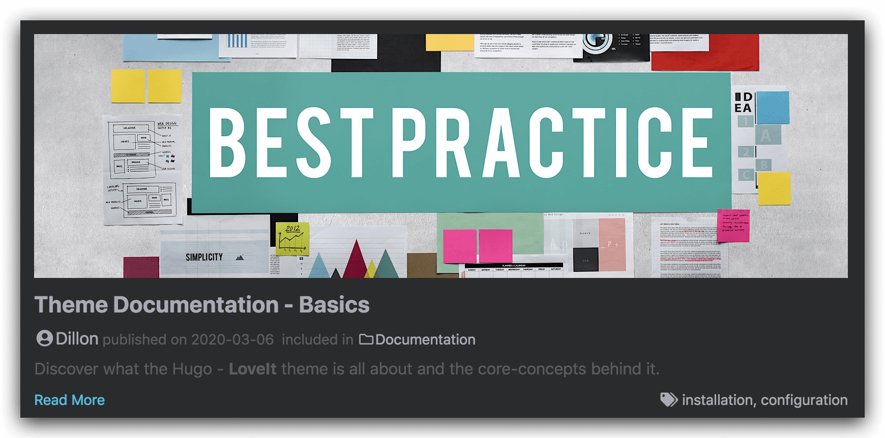
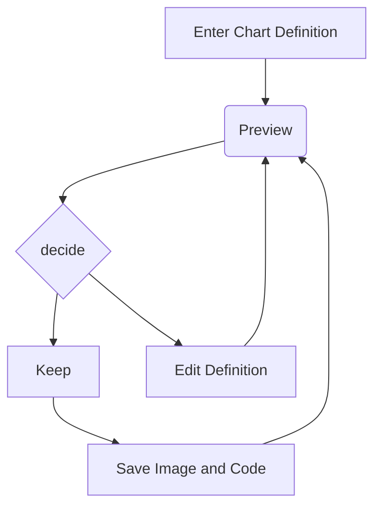

Find out how to create and organize your content quickly and intuitively in **LoveIt** theme.

<!--more-->

## 1 Contents Organization {#contents-organization}

A few suggestions to help you get a good looking site quickly:

* Keep post pages in the `content/posts` directory, for example: `content/posts/my-first-post.md`
* Keep other pages in the `content` directory, for example: `content/about.md`
* Local resources organization




There are three ways to reference local resources such as **images** and **music**:

1. Using [page resources](https://gohugo.io/content-management/page-resources/) in [page bundles](https://gohugo.io/content-management/page-bundles/).
   You can reference page resources by the value for `Resources.GetMatch` or the filepath of the resource relative to the page directory directly.
2. Store resources in the **assets** directory, which is `/assets` by default.
   The filepath of the resource to reference in the post is relative to the assets directory.
3. Store resources in the **static** directory, which is `/static` by default.
   The filepath of the resource to reference in the post is relative to the static directory.

The **priority** of references is also in the above order.

There are many places in the theme where the above local resource references can be used,
such as **links**, **images**, `image` shortcode, `music` shortcode and some params in the **front matter**.

 Images in page resources or in the assets directory are
[processed](https://gohugo.io/content-management/image-processing/) by Hugo.
This applies to Markdown images, the `image` shortcode, featured images and the home page avatar
(the header logo only gets its `width` and `height`):

* JPEG, PNG and WebP images get their `width` and `height`, which keeps the page from shifting while they load,
  and a `srcset` with a WebP copy up to 800 pixels wide,
  so browsers download a size that fits the screen.
  The original file is the last `srcset` candidate when it is wider, and the `src` of the image.
  Images follow their Exif orientation. Before Hugo 0.155.0, PNG and WebP images
  keep the original file so the browser can apply that orientation.
* GIF, BMP, TIFF and animated PNG or WebP images get their `width` and `height` only, so animations keep playing.
  So does an image Hugo cannot decode.
* SVG and other formats, files in the **static** directory and remote URLs are used as they are.
  Put an image in the page bundle or in **assets** to have it processed.

WebP copies need the extended edition of Hugo before 0.153.0; with the standard edition of those versions,
images only get their size.

The featured image of a post and the home page avatar are loaded at once with `fetchpriority="high"`,
because they are usually the largest element in the first screen.
Other images use the browser's native lazy loading (`loading="lazy"`).


## 2 Front Matter {#front-matter}

**Hugo** allows you to add front matter in `yaml`, `toml` or `json` to your content files.


**Not all** of the below front matters need to be set in each of your posts.
It is necessary only if the front matters and the `page` part in your [site configuration](../theme-documentation-basics#site-configuration) are inconsistent.


Here is a front matter example:

```yaml
---
title: "My First Post"
subtitle: ""
date: 2020-03-04T15:58:26+08:00
lastmod: 2020-03-04T15:58:26+08:00
draft: true
author: ""
authorLink: ""
description: ""
license: ""
images: []

tags: []
categories: []

featuredImage: ""
featuredImagePreview: ""

hiddenFromHomePage: false
hiddenFromSearch: false
twemoji: false
lightgallery: true
ruby: true
fraction: true
fontawesome: true
linkToMarkdown: true
rssFullText: false

toc:
  enable: true
  keepStatic: false
  auto: true
code:
  copy: true
  maxShownLines: 50
  render:
    goat: true
    mermaid: true
mermaid:
  renderer: pele
math:
  enable: false
  # ...
mapbox:
  # ...
share:
  enable: true
  # ...
comment:
  enable: true
  # ...
library:
  css:
    # someCSS = "some.css"
    # located in "assets/"
    # Or
    # someCSS = "https://cdn.example.com/some.css"
  js:
    # someJS = "some.js"
    # located in "assets/"
    # Or
    # someJS = "https://cdn.example.com/some.js"
seo:
  images: []
  # ...
---
```

* **title**: the title for the content.
* **subtitle**:  the subtitle for the content.
* **date**: the datetime assigned to this page, which is usually fetched from the `date` field in front matter, but this behaviour is configurable in the [site configuration](../theme-documentation-basics#site-configuration).
* **lastmod**: the datetime at which the content was last modified.
* **draft**: if `true`, the content will not be rendered unless the `--buildDrafts`/`-D` flag is passed to the `hugo` command.
* **author**: the author for the content.
* **authorLink**: the link of the author.
* **description**: the description for the content.
* **license**: the special license for this content.
* **images**: page images for Open Graph and Twitter Cards.

* **tags**: the tags for the content.
* **categories**: the categories for the content.

* **featuredImage**: the featured image for the content.
* **featuredImagePreview**: the featured image for the content preview in the home page.

* **hiddenFromHomePage**: if `true`, the content will not be shown in the home page.
* **hiddenFromSearch**:  if `true`, the content will not be shown in the search results.
* **twemoji**:  if `true`, the content will enable the twemoji.
* **lightgallery**: if `true`, images in the content will be shown as the gallery.
* **ruby**:  if `true`, the content will enable the [ruby extended syntax](#ruby).
* **fraction**:  if `true`, the content will enable the [fraction extended syntax](#fraction).
* **fontawesome**:  if `true`, the content will enable the [Font Awesome extended syntax](#fontawesome).
* **linkToMarkdown**: if `true`, the footer of the content will be shown the link to the original Markdown file.
* **rssFullText**:  if `true`, the full text content will be shown in RSS.

* **toc**:  the same as the `params.page.toc` part in the [site configuration](../theme-documentation-basics#site-configuration), including `enable`, `keepStatic` (whether to keep the static table of contents in front of the post) and `auto`.
* **code**:  the same as the `params.page.code` part in the [site configuration](../theme-documentation-basics#site-configuration), including `copy`, `maxShownLines` and `render.goat` / `render.mermaid` (see [Diagrams](#diagrams)).
* **mermaid**:  the same as the `params.page.mermaid` part in the [site configuration](../theme-documentation-basics#site-configuration), including `renderer` (see [Diagrams](#diagrams)).
* **math**:  the same as the `params.page.math` part in the [site configuration](../theme-documentation-basics#site-configuration).
* **mapbox**:  the same as the `params.page.mapbox` part in the [site configuration](../theme-documentation-basics#site-configuration).
* **share**: the same as the `params.page.share` part in the [site configuration](../theme-documentation-basics#site-configuration).
* **comment**:  the same as the `params.page.comment` part in the [site configuration](../theme-documentation-basics#site-configuration).
* **library**:  the same as the `params.page.library` part in the [site configuration](../theme-documentation-basics#site-configuration).
* **seo**:  the same as the `params.page.seo` part in the [site configuration](../theme-documentation-basics#site-configuration).


The theme shows `lastmod` as the "Updated on" date at the end of a page, and uses it in the sitemap and structured data.
Instead of setting it by hand, set `enableGitInfo = true` in the site configuration:
Hugo then uses the date of the last Git commit that changed the content file, ahead of `lastmod` in the front matter.
To change that order, configure [front matter dates](https://gohugo.io/configuration/front-matter/#dates) in Hugo.
Hugo uses the first source that has a date. This order lets `lastmod` in the front matter win over the Git date,
and falls back to the file's modification time for files Git does not track:

```toml
[frontmatter]
  lastmod = ["lastmod", ":git", ":fileModTime", ":default"]
```

Put `":fileModTime"` first to always use the file's modification time instead.

Commit dates need the Git history: when a build service clones only the latest commit,
every page gets that commit's date. With GitHub Actions, set `fetch-depth: 0` for `actions/checkout`.





**featuredImage** and **featuredImagePreview** support the complete usage of [local resource references](#contents-organization).

If the page resource with `name: featured-image` or `name: featured-image-preview` is set in the front matter,
it is not necessary to set the parameter `featuredImage` or `featuredImagePreview`:

```yaml
resources:
- name: featured-image
  src: featured-image.jpg
- name: featured-image-preview
  src: featured-image-preview.jpg
```





The images shown when a page is shared on social networks, and the images in its structured data,
come from the first of these that is set:

1. `seo.images` in the front matter
2. `images` in the front matter
3. the featured image: the `featured-image` resource or `featuredImage`, otherwise the `featured-image-preview` resource or `featuredImagePreview`
4. an image in the page bundle whose name contains `feature`, `cover` or `thumbnail`
5. `params.page.seo.images`, then `params.images`, then `params.seo.image` in the site configuration

Each image can be a page resource, the path of a file under `assets/` or `static/`, or a URL.
SVG images are left out of Open Graph and Twitter Cards because social networks cannot show them.


## 3 Content Summaries

**LoveIt** theme uses the summary of the content to display abstract information in the home page. Hugo can generate summaries of your content.



### Automatic Summary Splitting

By default, Hugo automatically takes the first 70 words of your content as its summary.

You may customize the summary length by setting `summaryLength` in the [site configuration](../theme-documentation-basics#site-configuration).

If you are creating content in a [CJK]^(Chinese/Japanese/Korean) language and want to use Hugo’s automatic summary splitting, set `hasCJKLanguage` to `true` in your [site configuration](../theme-documentation-basics#site-configuration).

### Manual Summary Splitting

Alternatively, you may add the `<!--more-->` summary divider where you want to split the article.

Content that comes before the summary divider will be used as that content’s summary.


Be careful to enter `<!--more-->` exactly; i.e., all lowercase and with no whitespace.


### Front Matter Summary

You might want your summary to be something other than the text that starts the article. In this case you can provide a separate summary in the `summary` variable of the article front matter.

### Use Description as Summary

You might want your description in the `description` variable of the article front matter as the summary.

You may add the `<!--more-->` summary divider at the start of the article. Keep content that comes before the summary divider empty. Then **LoveIt** theme will use your description as the summary.

### Priority Order of Summary Selection

Because there are multiple ways in which a summary can be specified it is useful to understand the order. It is as follows:

1. If there is a `<!--more-->` summary divider present in the article with content before it, the text up to the divider will be provided as per the manual summary split method.
2. Otherwise, if there is a summary variable in the article front matter, the value of the variable will be provided as per the front matter summary method.
3. Otherwise, if there is no `<!--more-->` summary divider, the text at the start of the article will be provided as per the automatic summary split method.
4. If the summary is still empty (for example, a `<!--more-->` divider with no content before it and no `summary` in the front matter), the `description` will be used as the summary.

In other words, the `description` is only a fallback: a `summary` in the front matter takes precedence over it, even if the article starts with an empty `<!--more-->` divider.


It is not recommended to include rich text block elements in the summary, which will cause typographic errors. Such as code blocks, pictures, tables, etc.


## 4 Basic Markdown Syntax

This part is shown in the [basic markdown syntax page](../basic-markdown-syntax/).

## 5 Extended Markdown Syntax {#extended-markdown-syntax}

**LoveIt** theme has some extended syntax elements for you to write articles.

### Diagrams

The `goat` and `mermaid` code blocks are rendered as diagrams by default.
Set `goat = false` or `mermaid = false` under `[params.page.code.render]` in your [site configuration](../theme-documentation-basics#site-configuration)
(or `code.render.goat` / `code.render.mermaid` in the front matter of a page) to turn the corresponding code block render hook off.
The code block then falls back to a plain code block.

 Mermaid diagrams are rendered with [Pele](https://pele.run) by default.
Set `renderer = "mermaid"` under `[params.page.mermaid]` (or `mermaid.renderer` in the front matter) to render them with the Mermaid library,
see the [mermaid shortcode](../theme-documentation-mermaid-shortcode#renderer) for the differences.

#### GoAT Diagrams (ASCII)

```goat
      .               .                .               .--- 1          .-- 1     / 1
     / \              |                |           .---+            .-+         +
    /   \         .---+---.         .--+--.        |   '--- 2      |   '-- 2   / \ 2
   +     +        |       |        |       |    ---+            ---+          +
  / \   / \     .-+-.   .-+-.     .+.     .+.      |   .--- 3      |   .-- 3   \ / 3
 /   \ /   \    |   |   |   |    |   |   |   |     '---+            '-+         +
 1   2 3   4    1   2   3   4    1   2   3   4         '--- 4          '-- 4     \ 4
```

#### Mermaid Diagrams



### Alerts {#alerts}



A blockquote that starts with an alert type is rendered in the same style as the [`admonition` shortcode](../theme-documentation-extended-shortcodes/#4-admonition),
and accepts the same types.

```markdown
> [!NOTE]
> An alert with the default title.

> [!TIP] A custom title
> An alert with a custom title.

> [!WARNING]- Collapsed by default
> Add `-` after the type to collapse the alert, or `+` to keep it open.
```

The rendered output looks like this:

> [!NOTE]
> An alert with the default title.

> [!TIP] A custom title
> An alert with a custom title.

> [!WARNING]- Collapsed by default
> Add `-` after the type to collapse the alert, or `+` to keep it open.

### Emoji Support

This part is shown in the [emoji support page](../emoji-support/).

### Mathematical Formula



**LoveIt** theme supports mathematical formulas based on [$\KaTeX$](https://katex.org/).

Set the property `enable = true` under `[params.page.math]` in your [site configuration](../theme-documentation-basics#site-configuration)
and the property `math: true` of the article front matter to enable the automatic rendering of mathematical formulas.
**$\KaTeX$** automatically renders formulas based on **specific delimiters**.


Here is a list of [$\TeX$ functions supported by $\KaTeX$](https://katex.org/docs/supported.html).



Since Hugo generates HTML documents according to the syntax such as `_`/`*`/`>>` when rendering Markdown documents,
and some text content in the form of escape characters
(such as `\(`/`\)`/`\[`/`\]`/`\\`) escape processing will be performed automatically,
therefore, additional escape character expressions are required for these places to achieve automatic rendering:

* `_` -> `\_`
* `*` -> `\*`
* `>>` -> `\>>`
* `\(` -> `\\(`
* `\)` -> `\\)`
* `\[` -> `\\[`
* `\]` -> `\\]`
* `\\` -> `\\\\`

**LoveIt** theme supports [`raw` shortcode](../theme-documentation-extended-shortcodes#12-raw) to avoid these escape characters,
which helps you write raw mathematical formula content.

Example `raw` input:

```markdown
Inline Formula: {?{}{< raw >}}\(\mathbf{E}=\sum_{i} \mathbf{E}_{i}=\mathbf{E}_{1}+\mathbf{E}_{2}+\mathbf{E}_{3}+\cdots\){?{}{< /raw >}}

Block Formula:

{?{}{< raw >}}
\[ a=b+c \\ d+e=f \]
{?{}{< /raw >}}
```

The rendered output looks like this:

Inline Formula: \(\mathbf{E}=\sum_{i} \mathbf{E}_{i}=\mathbf{E}_{1}+\mathbf{E}_{2}+\mathbf{E}_{3}+\cdots\)

Block Formula:


\[ a=b+c \\ d+e=f \]



#### Inline Formula

The default inline delimiters are:

* `$ ... $`
* `\( ... \)` (escaped: `\\( ... \\)`)

For example:

```markdown
$c = \pm\sqrt{a^2 + b^2}$ and \\(f(x)=\int_{-\infty}^{\infty} \hat{f}(\xi) e^{2 \pi i \xi x} d \xi\\)
```

The rendered output looks like this:

$c = \pm\sqrt{a^2 + b^2}$ and \\(f(x)=\int_{-\infty}^{\infty} \hat{f}(\xi) e^{2 \pi i \xi x} d \xi\\)

#### Block Formula

The default block delimiters are:

* `$$ ... $$`
* `\[ ... \]` (escaped: `\\[ ... \\]`)
* `\begin{equation} ... \end{equation}` (unnumbered: `\begin{equation*} ... \end{equation*}`)
* `\begin{align} ... \end{align}` (unnumbered: `\begin{align*} ... \end{align*}`)
* `\begin{alignat} ... \end{alignat}` (unnumbered: `\begin{alignat*} ... \end{alignat*}`)
* `\begin{gather} ... \end{gather}` (unnumbered: `\begin{gather*} ... \end{gather*}`)
* `\begin{CD} ... \end{CD}`

For example:

```markdown
$$ c = \pm\sqrt{a^2 + b^2} $$

\\[ f(x)=\int_{-\infty}^{\infty} \hat{f}(\xi) e^{2 \pi i \xi x} d \xi \\]

\begin{equation*}
  \rho \frac{\mathrm{D} \mathbf{v}}{\mathrm{D} t}=\nabla \cdot \mathbb{P}+\rho \mathbf{f}
\end{equation*}

\begin{equation}
  \mathbf{E}=\sum_{i} \mathbf{E}\_{i}=\mathbf{E}\_{1}+\mathbf{E}\_{2}+\mathbf{E}_{3}+\cdots
\end{equation}

\begin{align}
  a&=b+c \\\\
  d+e&=f
\end{align}

\begin{alignat}{2}
   10&x+&3&y = 2 \\\\
   3&x+&13&y = 4
\end{alignat}

\begin{gather}
   a=b \\\\
   e=b+c
\end{gather}

\begin{CD}
   A @>a\>> B \\\\
@VbVV @AAcA \\\\
   C @= D
\end{CD}
```

The rendered output looks like this:

$$ c = \pm\sqrt{a^2 + b^2} $$

\\[ f(x)=\int_{-\infty}^{\infty} \hat{f}(\xi) e^{2 \pi i \xi x} d \xi \\]

\begin{equation*}
  \rho \frac{\mathrm{D} \mathbf{v}}{\mathrm{D} t}=\nabla \cdot \mathbb{P}+\rho \mathbf{f}
\end{equation*}

\begin{equation}
  \mathbf{E}=\sum_{i} \mathbf{E}\_{i}=\mathbf{E}\_{1}+\mathbf{E}\_{2}+\mathbf{E}_{3}+\cdots
\end{equation}

\begin{align}
  a&=b+c \\\\
  d+e&=f
\end{align}

\begin{alignat}{2}
   10&x+&3&y = 2 \\\\
   3&x+&13&y = 4
\end{alignat}

\begin{gather}
   a=b \\\\
   e=b+c
\end{gather}

\begin{CD}
   A @>a\>> B \\\\
@VbVV @AAcA \\\\
   C @= D
\end{CD}


You can add more inline and block delimiters in your [site configuration](../theme-documentation-basics#site-configuration).


#### Copy-tex

**[Copy-tex](https://github.com/Khan/KaTeX/tree/master/contrib/copy-tex)** is an extension for **$\KaTeX$**.

By the extension, when selecting and copying $\KaTeX$ rendered elements, copies their $\LaTeX$ source to the clipboard.

Copy-tex is on by default when math is enabled. Set the property `copyTex = false` under `[params.page.math]` in your [site configuration](../theme-documentation-basics#site-configuration) to disable it.

Select and copy the formula rendered in the previous section, and you can find that the copied content is the $\LaTeX$ source code.

#### mhchem

**[mhchem](https://github.com/Khan/KaTeX/tree/master/contrib/mhchem)** is an extension for **$\KaTeX$**.

By the extension, you can write beautiful chemical equations easily in the article.

mhchem is on by default when math is enabled. Set the property `mhchem = false` under `[params.page.math]` in your [site configuration](../theme-documentation-basics#site-configuration) to disable it.

```markdown
$$ \ce{CO2 + C -> 2 CO} $$

$$ \ce{Hg^2+ ->[I-] HgI2 ->[I-] [Hg^{II}I4]^2-} $$
```

The rendered output looks like this:

$$ \ce{CO2 + C -> 2 CO} $$

$$ \ce{Hg^2+ ->[I-] HgI2 ->[I-] [Hg^{II}I4]^2-} $$

#### Server-side Rendering



**LoveIt** theme also provides a [passthrough render hook](https://gohugo.io/render-hooks/passthrough/),
which renders formulas into HTML at build time with Hugo's [`transform.ToMath`](https://gohugo.io/functions/transform/tomath/).
These formulas need neither the extra escape characters above nor JavaScript: when `[params.page.math]` is disabled, pages that contain them only load the $\KaTeX$ stylesheet.

Hugo does not read the `markup` configuration from themes, so enable the Goldmark passthrough extension in your own [site configuration](../theme-documentation-basics#site-configuration):

```toml
[markup.goldmark.extensions.passthrough]
  enable = true
  [markup.goldmark.extensions.passthrough.delimiters]
    block = [["\\[", "\\]"], ["$$", "$$"]]
    inline = [["\\(", "\\)"]]
```


Formulas between these delimiters are rendered on the server whether or not `[params.page.math]` is enabled,
and an invalid formula stops the build with its position.


### Ruby Annotation {#ruby}

An extended Markdown syntax for **ruby annotation** is supported in **LoveIt** theme:

```markdown
[Hugo]{?^}(An open-source static site generator)
```

The rendered output looks like this:

[Hugo]^(An open-source static site generator)

### Fraction {#fraction}



An extended Markdown syntax for **fraction** is supported in **LoveIt** theme:

```markdown
[Light]{?/}[Dark]

[99]{?/}[100]
```

The rendered output looks like this:

[Light]/[Dark]

[99]/[100]

### Font Awesome {#fontawesome}

**LoveIt** theme uses [Font Awesome](https://fontawesome.com/) as the icon library.
You can easily use these icons in your articles.

Get the `class` of icons you wanted from the [Font Awesome website](https://fontawesome.com/icons?d=gallery).

```markdown
Gone camping! {?:}(fas fa-campground): Be back soon.

That is so funny! {?:}(far fa-grin-tears):
```

The rendered output looks like this:

Gone camping! :(fas fa-campground): Be back soon.

That is so funny! :(far fa-grin-tears):

### Escape character {#escape-character}

In some special cases (when writing this theme documentation :(far fa-grin-squint-tears):),
your content will conflict with basic or extended Markdown syntax, and it is inevitable.

The escape character syntax can help you build the content you wanted:

```markdown
{{??}X} -> X
```

For example, two `:` will enable emoji syntax, which is not the behavior you want. The escape character syntax is like this:

```markdown
{{??}:}joy:
```

The rendered output looks like this:

**{?:}joy{?:}** instead of **:joy:**


This is related to **[an issue for Hugo](https://github.com/gohugoio/hugo/issues/4978)**, which has not been resolved.


Another example is:

```markdown
[link{{??}]}(#escape-character)
```

The rendered output looks like this:

**[link{?]}(#escape-character)** instead of **[link](#escape-character)**.
