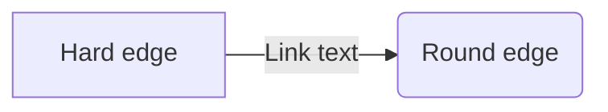



The `mermaid` shortcode supports diagrams in Hugo with the [Mermaid](https://mermaid.js.org/) syntax.

<!--more-->

**Mermaid** is a library helping you to generate diagram and flowcharts from text, in a similar manner as Markdown.

Just insert your mermaid code in the `mermaid` shortcode and that’s it.

A fenced code block with the `mermaid` language is rendered as a diagram too. This is controlled by `[params.page.code.render] mermaid` in the [site configuration](../theme-documentation-basics#site-configuration) (enabled by default) and can be overridden per page with `code.render.mermaid` in the [front matter](../theme-documentation-content#front-matter).

````markdown

````

## Renderer {#renderer}

 Diagrams are rendered with [Pele](https://pele.run) by default. Set `renderer` in `[params.page.mermaid]` of the [site configuration](../theme-documentation-basics#site-configuration), or `mermaid.renderer` in the [front matter](../theme-documentation-content#front-matter) of a page, to choose the renderer:

* `"pele"`: Pele is a small renderer for the Mermaid syntax. It loads much less JavaScript than Mermaid, draws faster, lays diagrams out again for narrow screens and offers zoom buttons when a diagram is shrunk to fit. Its colors follow the light and dark themes without drawing the diagrams again.
* `"mermaid"`: the [Mermaid](https://mermaid.js.org/) library.

```toml
[params.page.mermaid]
  renderer = "mermaid"
```

Each page loads only the library of its renderer. Pele supports the diagram types of Mermaid 12.1, with some [differences](https://pele.run/compatibility):

* Pele has its own layout engine and style, so diagrams do not look exactly like Mermaid's. Mermaid themes do not apply; the theme sets the colors through [CSS variables](https://pele.run/theming), which you can override in `assets/css/_custom.scss`:

  ```scss
  .mermaid {
    --pele-accent: #c62f6c;
  }

  [theme=dark] .mermaid {
    --pele-accent: #ff7aa8;
  }
  ```

* Labels can't contain HTML. `click` statements open links, but JavaScript callbacks are ignored. Icons such as `fa:fa-car` are not drawn.
* Math (`$$...$$`) in labels is typeset with KaTeX only on pages where KaTeX is loaded (see `params.page.math`). Elsewhere the TeX source is shown.
* A diagram that can't be drawn shows the error in its place.

Choose `"mermaid"` if your diagrams rely on any of these.

 The Mermaid renderer uses the Mermaid `securityLevel` set to `strict`, which disables `click` interactions and restricts HTML in labels. If you trust the diagram sources and need these features, set `mermaidSecurityLevel = "loose"` in `[params.security]` of the [site configuration](../theme-documentation-basics#site-configuration). Pele has no HTML labels or JavaScript callbacks, so this option has no effect on it, and a build warning reminds you to choose the Mermaid renderer.

## Flowchart {#flowchart}

Example **flowchart** `mermaid` input:

```markdown

graph LR;
    A[Hard edge] -->|Link text| B(Round edge)
    B --> C{Decision}
    C -->|One| D[Result one]
    C -->|Two| E[Result two]

```

The rendered output looks like this (should work both on the home page and on the single post page):


graph LR;
    A[Hard edge] -->|Link text| B(Round edge)
    B --> C{Decision}
    C -->|One| D[Result one]
    C -->|Two| E[Result two]


## Sequence Diagram {#sequence-diagram}

Example **sequence diagram** `mermaid` input:

```markdown

sequenceDiagram
    participant Alice
    participant Bob
    Alice->>John: Hello John, how are you?
    loop Healthcheck
        John->John: Fight against hypochondria
    end
    Note right of John: Rational thoughts <br/>prevail...
    John-->Alice: Great!
    John->Bob: How about you?
    Bob-->John: Jolly good!

```

The rendered output looks like this:


sequenceDiagram
    participant Alice
    participant Bob
    Alice->>John: Hello John, how are you?
    loop Healthcheck
        John->John: Fight against hypochondria
    end
    Note right of John: Rational thoughts <br/>prevail...
    John-->Alice: Great!
    John->Bob: How about you?
    Bob-->John: Jolly good!


## Gantt {#gantt}

Example **Gantt** `mermaid` input:

```markdown

gantt
dateFormat  YYYY-MM-DD
title Adding GANTT diagram to mermaid
excludes weekdays 2014-01-10

section A section
Completed task            :done,    des1, 2014-01-06,2014-01-08
Active task               :active,  des2, 2014-01-09, 3d
Future task               :         des3, after des2, 5d
Future task2              :         des4, after des3, 5d

```

The rendered output looks like this:


gantt
dateFormat  YYYY-MM-DD
title Adding GANTT diagram to mermaid
excludes weekdays 2014-01-10

section A section
Completed task            :done,    des1, 2014-01-06,2014-01-08
Active task               :active,  des2, 2014-01-09, 3d
Future task               :         des3, after des2, 5d
Future task2              :         des4, after des3, 5d


## Class Diagram {#class-diagram}

Example **class diagram** `mermaid` input:

```markdown

classDiagram
    Animal <|-- Duck
    Animal <|-- Fish
    Animal <|-- Zebra
    Animal : +int age
    Animal : +String gender
    Animal: +isMammal()
    Animal: +mate()
    class Duck{
        +String beakColor
        +swim()
        +quack()
    }
    class Fish{
        -int sizeInFeet
        -canEat()
    }
    class Zebra{
        +bool is_wild
        +run()
    }

```

The rendered output looks like this:


classDiagram
    Animal <|-- Duck
    Animal <|-- Fish
    Animal <|-- Zebra
    Animal : +int age
    Animal : +String gender
    Animal: +isMammal()
    Animal: +mate()
    class Duck{
        +String beakColor
        +swim()
        +quack()
    }
    class Fish{
        -int sizeInFeet
        -canEat()
    }
    class Zebra{
        +bool is_wild
        +run()
    }


## State Diagram {#state-diagram}

Example **state diagram** `mermaid` input:

```markdown

stateDiagram-v2
    [*] --> Still
    Still --> [*]
    Still --> Moving
    Moving --> Still
    Moving --> Crash
    Crash --> [*]

```

The rendered output looks like this:


stateDiagram-v2
    [*] --> Still
    Still --> [*]
    Still --> Moving
    Moving --> Still
    Moving --> Crash
    Crash --> [*]


## Git Graph {#git-graph}

Example **git graph** `mermaid` input:

```markdown

gitGraph
    commit
    commit
    branch develop
    checkout develop
    commit
    commit
    checkout main
    merge develop
    commit
    commit

```

The rendered output looks like this:


gitGraph
    commit
    commit
    branch develop
    checkout develop
    commit
    commit
    checkout main
    merge develop
    commit
    commit


## Entity Relationship Diagram {#entity-relationship-diagram}

Example **entity-relationship diagram** `mermaid` input:

```markdown

erDiagram
    CUSTOMER ||--o{ ORDER : places
    ORDER ||--|{ LINE-ITEM : contains
    CUSTOMER }|..|{ DELIVERY-ADDRESS : uses

```

The rendered output looks like this:


erDiagram
    CUSTOMER ||--o{ ORDER : places
    ORDER ||--|{ LINE-ITEM : contains
    CUSTOMER }|..|{ DELIVERY-ADDRESS : uses


## User Journey {#user-journey}

Example **user journey** `mermaid` input:

```markdown

journey
    title My working day
    section Go to work
      Make tea: 5: Me
      Go upstairs: 3: Me
      Do work: 1: Me, Cat
    section Go home
      Go downstairs: 5: Me
      Sit down: 5: Me

```

The rendered output looks like this:


journey
    title My working day
    section Go to work
      Make tea: 5: Me
      Go upstairs: 3: Me
      Do work: 1: Me, Cat
    section Go home
      Go downstairs: 5: Me
      Sit down: 5: Me


## Pie Chart {#pie-chart}

Example **pie chart** `mermaid` input:

```markdown

pie
    "Dogs" : 386
    "Cats" : 85
    "Rats" : 15

```

The rendered output looks like this:


pie
    "Dogs" : 386
    "Cats" : 85
    "Rats" : 15


## Requirement Diagram {#requirement-diagram}

Example **requirement diagram** `mermaid` input:

```markdown

requirementDiagram

requirement test_req {
id: 1
text: the test text.
risk: high
verifymethod: test
}

element test_entity {
type: simulation
}

test_entity - satisfies -> test_req

```

The rendered output looks like this:


requirementDiagram

requirement test_req {
id: 1
text: the test text.
risk: high
verifymethod: test
}

element test_entity {
type: simulation
}

test_entity - satisfies -> test_req

