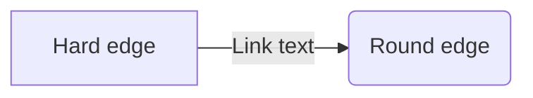



`mermaid` shortcode 使用 [Mermaid](https://mermaid.js.org/) 语法提供绘制图表和流程图的功能.

<!--more-->

[mermaid](https://mermaid.js.org/) 是一个可以帮助你在文章中绘制图表和流程图的库, 类似 Markdown 的语法.

只需将你的 mermaid 代码插入 `mermaid` shortcode 中即可.

语言为 `mermaid` 的围栏代码块也会被渲染为图表. 该功能由[网站配置](../theme-documentation-basics#site-configuration)中的 `[params.page.code.render] mermaid` 控制 (默认开启), 也可以在[前置参数](../theme-documentation-content#front-matter)中通过 `code.render.mermaid` 针对单篇文章覆盖.

````markdown

````

## 渲染器 {#renderer}

 图表默认使用 [Pele](https://pele.run) 渲染. 在[网站配置](../theme-documentation-basics#site-configuration)的 `[params.page.mermaid]` 中设置 `renderer`, 或者在文章[前置参数](../theme-documentation-content#front-matter)中设置 `mermaid.renderer`, 可以选择渲染器:

* `"pele"`: Pele 是一个轻量的 Mermaid 语法渲染器. 它加载的 JavaScript 比 Mermaid 少得多, 渲染更快, 会为窄屏重新布局图表, 并在图表缩小以适应宽度时提供缩放按钮. 它的颜色跟随浅色和深色主题, 切换主题时无需重新渲染图表.
* `"mermaid"`: [Mermaid](https://mermaid.js.org/) 库.

```toml
[params.page.mermaid]
  renderer = "mermaid"
```

每个页面只加载所选渲染器的库. Pele 支持 Mermaid 12.1 的图表类型, 但存在一些[差异](https://pele.run/compatibility):

* Pele 使用自己的布局引擎和样式, 所以图表和 Mermaid 的外观并不完全相同. Mermaid 主题不会生效, 主题通过 [CSS 变量](https://pele.run/theming) 设置颜色, 你可以在 `assets/css/_custom.scss` 中覆盖这些变量:

  ```scss
  .mermaid {
    --pele-accent: #c62f6c;
  }

  [theme=dark] .mermaid {
    --pele-accent: #ff7aa8;
  }
  ```

* 标签中不能包含 HTML. `click` 语句可以打开链接, 但会忽略 JavaScript 回调. 不会绘制 `fa:fa-car` 这类图标.
* 只有在加载了 KaTeX 的页面 (见 `params.page.math`) 上, 标签中的数学公式 (`$$...$$`) 才会使用 KaTeX 排版, 其它页面会显示 TeX 源码.
* 无法绘制的图表会在原位置显示错误信息.

如果你的图表依赖以上任何一项, 请选择 `"mermaid"`.

 Mermaid 渲染器使用 Mermaid 的 `strict` 安全级别 (`securityLevel`), 这会禁用 `click` 交互并限制标签中的 HTML. 如果你信任图表的来源并需要这些功能, 可以在[网站配置](../theme-documentation-basics#site-configuration)的 `[params.security]` 中设置 `mermaidSecurityLevel = "loose"`. Pele 不支持 HTML 标签和 JavaScript 回调, 这个选项对它没有作用, 构建时会输出警告提醒你选择 Mermaid 渲染器.

## 流程图 {#flowchart}

一个 **流程图** `mermaid` 示例:

```markdown

graph LR;
    A[Hard edge] -->|Link text| B(Round edge)
    B --> C{Decision}
    C -->|One| D[Result one]
    C -->|Two| E[Result two]

```

呈现的输出效果如下:


graph LR;
    A[Hard edge] -->|Link text| B(Round edge)
    B --> C{Decision}
    C -->|One| D[Result one]
    C -->|Two| E[Result two]


## 时序图 {#sequence-diagram}

一个 **时序图** `mermaid` 示例:

```markdown

sequenceDiagram
    participant Alice
    participant Bob
    Alice->>John: Hello John, how are you?
    loop Healthcheck
        John->John: Fight against hypochondria
    end
    Note right of John: Rational thoughts <br/>prevail...
    John-->Alice: Great!
    John->Bob: How about you?
    Bob-->John: Jolly good!

```

呈现的输出效果如下:


sequenceDiagram
    participant Alice
    participant Bob
    Alice->>John: Hello John, how are you?
    loop Healthcheck
        John->John: Fight against hypochondria
    end
    Note right of John: Rational thoughts <br/>prevail...
    John-->Alice: Great!
    John->Bob: How about you?
    Bob-->John: Jolly good!


## 甘特图 {#gantt}

一个 **甘特图** `mermaid` 示例:

```markdown

gantt
dateFormat  YYYY-MM-DD
title Adding GANTT diagram to mermaid
excludes weekdays 2014-01-10

section A section
Completed task            :done,    des1, 2014-01-06,2014-01-08
Active task               :active,  des2, 2014-01-09, 3d
Future task               :         des3, after des2, 5d
Future task2              :         des4, after des3, 5d

```

呈现的输出效果如下:


gantt
dateFormat  YYYY-MM-DD
title Adding GANTT diagram to mermaid
excludes weekdays 2014-01-10

section A section
Completed task            :done,    des1, 2014-01-06,2014-01-08
Active task               :active,  des2, 2014-01-09, 3d
Future task               :         des3, after des2, 5d
Future task2              :         des4, after des3, 5d


## 类图 {#class-diagram}

一个 **类图** `mermaid` 示例:

```markdown

classDiagram
    Animal <|-- Duck
    Animal <|-- Fish
    Animal <|-- Zebra
    Animal : +int age
    Animal : +String gender
    Animal: +isMammal()
    Animal: +mate()
    class Duck{
        +String beakColor
        +swim()
        +quack()
    }
    class Fish{
        -int sizeInFeet
        -canEat()
    }
    class Zebra{
        +bool is_wild
        +run()
    }

```

呈现的输出效果如下:


classDiagram
    Animal <|-- Duck
    Animal <|-- Fish
    Animal <|-- Zebra
    Animal : +int age
    Animal : +String gender
    Animal: +isMammal()
    Animal: +mate()
    class Duck{
        +String beakColor
        +swim()
        +quack()
    }
    class Fish{
        -int sizeInFeet
        -canEat()
    }
    class Zebra{
        +bool is_wild
        +run()
    }


## 状态图 {#state-diagram}

一个 **状态图** `mermaid` 示例:

```markdown

stateDiagram-v2
    [*] --> Still
    Still --> [*]
    Still --> Moving
    Moving --> Still
    Moving --> Crash
    Crash --> [*]

```

呈现的输出效果如下:


stateDiagram-v2
    [*] --> Still
    Still --> [*]
    Still --> Moving
    Moving --> Still
    Moving --> Crash
    Crash --> [*]


## Git 图 {#git-graph}

一个 **Git 图** `mermaid` 示例:

```markdown

gitGraph
    commit
    commit
    branch develop
    checkout develop
    commit
    commit
    checkout main
    merge develop
    commit
    commit

```

呈现的输出效果如下:


gitGraph
    commit
    commit
    branch develop
    checkout develop
    commit
    commit
    checkout main
    merge develop
    commit
    commit


## 实体关系图 {#entity-relationship-diagram}

一个 **实体关系图** `mermaid` 示例:

```markdown

erDiagram
    CUSTOMER ||--o{ ORDER : places
    ORDER ||--|{ LINE-ITEM : contains
    CUSTOMER }|..|{ DELIVERY-ADDRESS : uses

```

呈现的输出效果如下:


erDiagram
    CUSTOMER ||--o{ ORDER : places
    ORDER ||--|{ LINE-ITEM : contains
    CUSTOMER }|..|{ DELIVERY-ADDRESS : uses


## 用户体验旅程图 {#user-journey}

一个 **用户体验旅程图** `mermaid` 示例:

```markdown

journey
    title My working day
    section Go to work
      Make tea: 5: Me
      Go upstairs: 3: Me
      Do work: 1: Me, Cat
    section Go home
      Go downstairs: 5: Me
      Sit down: 5: Me

```

呈现的输出效果如下:


journey
    title My working day
    section Go to work
      Make tea: 5: Me
      Go upstairs: 3: Me
      Do work: 1: Me, Cat
    section Go home
      Go downstairs: 5: Me
      Sit down: 5: Me


## 饼图 {#pie-chart}

一个 **饼图** `mermaid` 示例:

```markdown

pie
    "Dogs" : 386
    "Cats" : 85
    "Rats" : 15

```

呈现的输出效果如下:


pie
    "Dogs" : 386
    "Cats" : 85
    "Rats" : 15


## 需求图 {#requirement-diagram}

一个 **需求图** `mermaid` 示例:

```markdown

requirementDiagram

requirement test_req {
id: 1
text: the test text.
risk: high
verifymethod: test
}

element test_entity {
type: simulation
}

test_entity - satisfies -> test_req

```

呈现的输出效果如下:


requirementDiagram

requirement test_req {
id: 1
text: the test text.
risk: high
verifymethod: test
}

element test_entity {
type: simulation
}

test_entity - satisfies -> test_req

