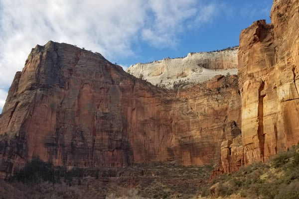
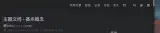

The bundle's featured image is 600×400. The JPEG below is stored 600×400 with Exif orientation 6, so it is shown 400×600.



A PNG stored 60×40 with Exif orientation 6 is shown 40×60.

Animated PNG and WebP keep their animation, so they get no WebP copies.

A width of 0 counts as missing.



A JPEG with Exif orientation 6 whose image data is cut short keeps its size and is used as it is.

