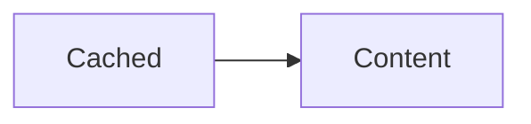


First typed line



Second typed line


Raw HTML

Styled text

window.scriptOrder = ['first'];

window.scriptOrder.push('second');


Nested alpha
window.scriptOrder.push('nested a');



Nested beta
window.scriptOrder.push('nested b');


